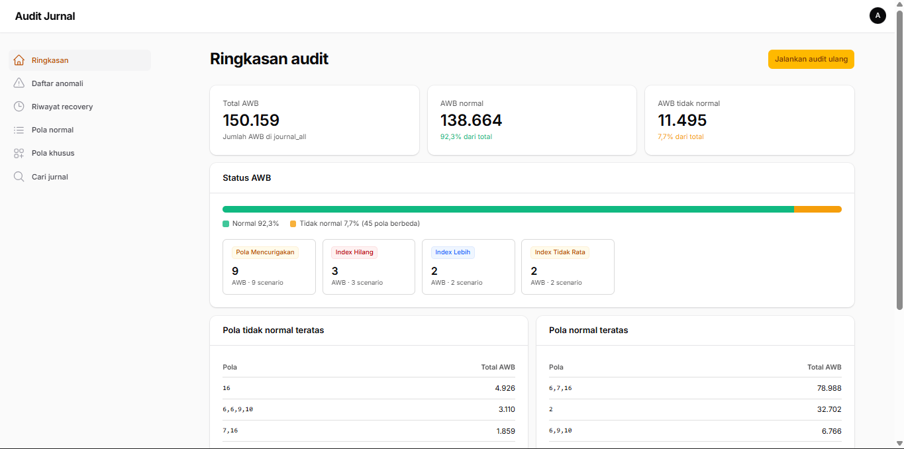
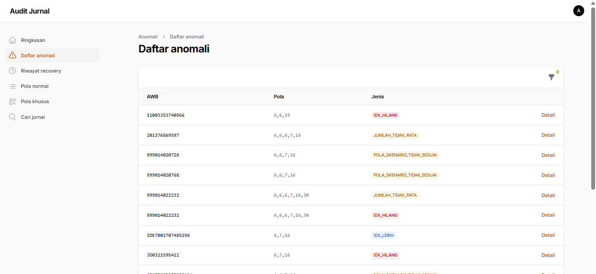
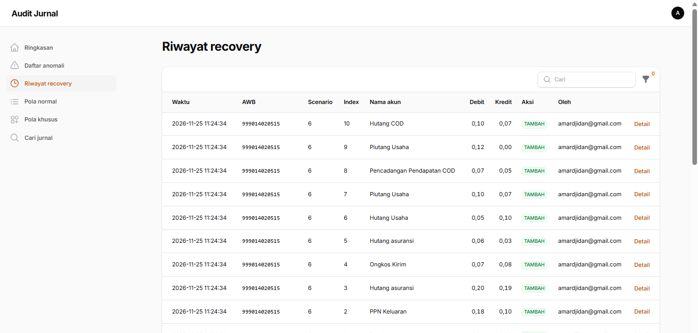
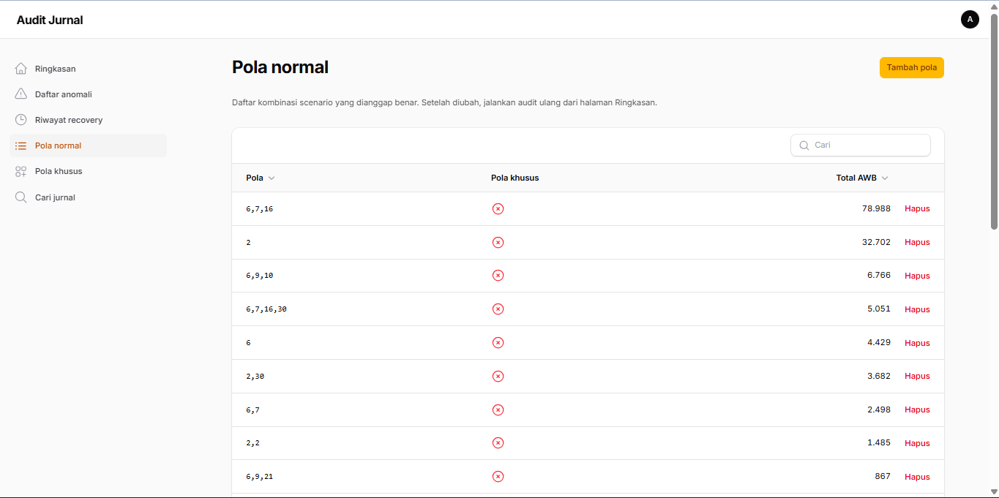
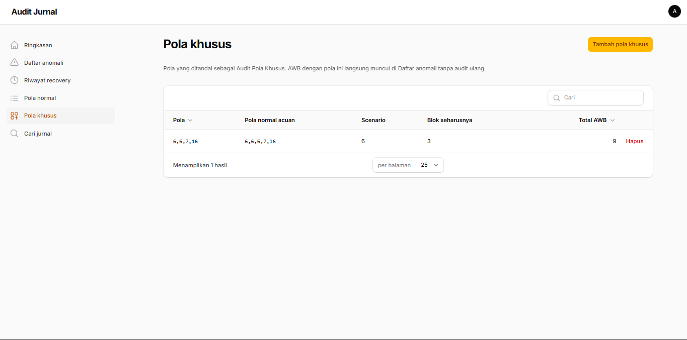
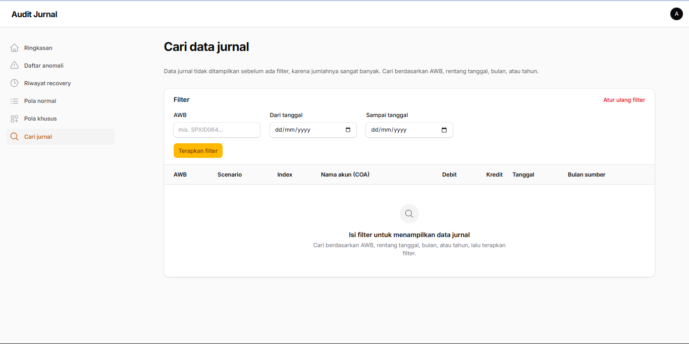

# Microservice Recovery System — Audit Jurnal

Sistem untuk **mendeteksi, mengukur, dan memperbaiki data jurnal akuntansi yang rusak atau hilang** akibat microservice yang down. Sistem membandingkan jurnal yang tercatat dengan pola jurnal yang seharusnya terbentuk untuk setiap kejadian (scenario), lalu menampilkan anomalinya di dashboard admin beserta alat untuk memperbaikinya.

## Latar Belakang

Ketika sebuah microservice down, sebagian transaksi bisa tercatat tidak lengkap: ada baris jurnal yang hilang, kurang, atau berlebih. Mengecek ini secara manual pada data berjumlah besar tidak realistis. Sistem ini mengotomatiskan prosesnya:

1. **Menemukan** AWB (referensi) yang jurnalnya tidak sesuai pola normal.
2. **Mengukur** dampaknya: baris apa yang hilang atau berlebih, dan berapa nominalnya.
3. **Memperbaiki** data lewat proses recovery yang terkonfirmasi dan tercatat (audit trail).

## Fitur

- **Ringkasan** — gambaran umum jumlah anomali dan status audit.
- **Daftar anomali** — referensi/AWB yang jurnalnya menyimpang dari pola normal, beserta detail baris yang kurang atau berlebih.
- **Riwayat recovery** — log semua tindakan perbaikan data (siapa, kapan, apa yang diubah).
- **Pola normal** — daftar kombinasi scenario yang dianggap valid.
- **Pola khusus** — tambah atau hapus pola kombinasi scenario yang dikecualikan dari anomali.
- **Cari jurnal** — pencarian data jurnal berdasarkan AWB, rentang tanggal, bulan, atau tahun. Data tidak dimuat sebelum ada filter karena jumlahnya sangat banyak.
- **Repair dengan konfirmasi** — perbaikan per baris dengan nominal yang bisa diisi, dan setiap aksi dicatat ke `audit_repair_log`.

## Tampilan Sistem

| Halaman | Screenshot |
|---|---|
| Ringkasan |  |
| Daftar anomali |  |
| Riwayat recovery |  |
| Pola normal |  |
| Pola khusus |  |
| Cari jurnal |  |

## Cara Kerja Deteksi

Setiap scenario (misalnya *Pickup COD*) punya cetakan baris jurnal yang tetap: kombinasi `scenario + index + nama akun (COA)`. Pipeline audit di PostgreSQL membandingkan jurnal yang ada dengan cetakan tersebut untuk setiap `referensi`.

1. Semua jurnal digabung ke satu tabel `journal_all`.
2. `scenario_template` menyimpan cetakan baris per scenario.
3. `normal_scenario_patterns` menyimpan kombinasi scenario yang valid.
4. Materialized view menghitung jumlah baris per index, mengenali scenario yang terjadi pada tiap referensi, dan menyusun pola lengkap per referensi.
5. View `audit_anomali` menampilkan referensi yang barisnya kurang, berlebih, atau polanya tidak dikenali.
6. Procedure `refresh_audit()` menyegarkan semua hasil di atas.

### Keterbatasan yang diketahui

Jika **satu kejadian scenario hilang utuh dan merata** (semua index turun dengan jumlah yang sama), deteksi berbasis jumlah baris tidak melihatnya. Kasus ini hanya tertangkap bila pola hasilnya tidak dikenali oleh pencocokan pola yang memperhitungkan pengulangan.

## Teknologi

| Komponen | Teknologi |
|---|---|
| Backend | Laravel (PHP) |
| Admin UI | Filament v4 (panel "Audit Jurnal") |
| Database | PostgreSQL |
| Autentikasi API | Laravel Sanctum |

## Struktur Repo

```
microservice-recovery/
├── platform/          # Aplikasi Laravel + panel Filament
│   ├── app/
│   │   ├── Filament/Pages/   # Halaman admin (Cari jurnal, dll.)
│   │   └── Services/         # AuditApi, AuditService
│   ├── routes/
│   └── resources/
└── hapus_blade.ps1    # Script pembersih UI Blade lama (sekali pakai)
```

## Instalasi

### Prasyarat

- PHP 8.2+ dan Composer
- PostgreSQL
- Node.js (jika perlu build aset)

### Langkah

```bash
# 1. Clone repo
git clone https://github.com/amardjidan/microservice-recovery-system.git
cd microservice-recovery-system/platform

# 2. Install dependensi
composer install

# 3. Konfigurasi environment
cp .env.example .env
php artisan key:generate
```

Atur koneksi database di `.env`:

```env
DB_CONNECTION=pgsql
DB_HOST=127.0.0.1
DB_PORT=5432
DB_DATABASE=microservice_recoverysystem
DB_USERNAME=postgres
DB_PASSWORD=
```

```bash
# 4. Migrasi
php artisan migrate

# 5. Buat user admin untuk panel Filament
php artisan make:filament-user

# 6. Jalankan server
php artisan serve
```

Buka `http://127.0.0.1:8000/admin` lalu login.

### Menyiapkan data audit

1. Import data jurnal (Excel) ke PostgreSQL dan gabungkan ke tabel `journal_all`.
2. Isi `scenario_template` dan `normal_scenario_patterns`.
3. Buat materialized view dan view audit, lalu jalankan:

```sql
CALL refresh_audit();
```

## API

Semua endpoint berada di prefix `/audit` dan memerlukan autentikasi (`auth:sanctum`).

| Method | Endpoint | Fungsi |
|---|---|---|
| GET | `/audit/summary` | Ringkasan audit |
| GET | `/audit/anomalies` | Daftar anomali |
| GET | `/audit/references/{referensi}` | Detail satu referensi |
| POST | `/audit/references/{referensi}/repair` | Perbaiki data (dengan konfirmasi dan nominal per baris) |
| GET / POST / DELETE | `/audit/patterns` | Lihat, tambah, hapus pola |
| POST | `/audit/refresh` | Segarkan hasil audit |

## Pengujian

Logika deteksi divalidasi dengan merusak data uji secara sengaja (menghapus sebagian baris dan menghapus seluruh index pada referensi uji), lalu memastikan anomalinya terdeteksi. Endpoint API diuji menggunakan Postman.

## Pengembangan Lanjutan

- Notifikasi otomatis (Slack/email) saat anomali baru terdeteksi.
- Mode *dry-run* sebelum perbaikan dijalankan.
- Penanganan kasus kehilangan scenario yang merata (lihat Keterbatasan).

## Penulis

**amardjidan** — dikembangkan sebagai proyek magang.
